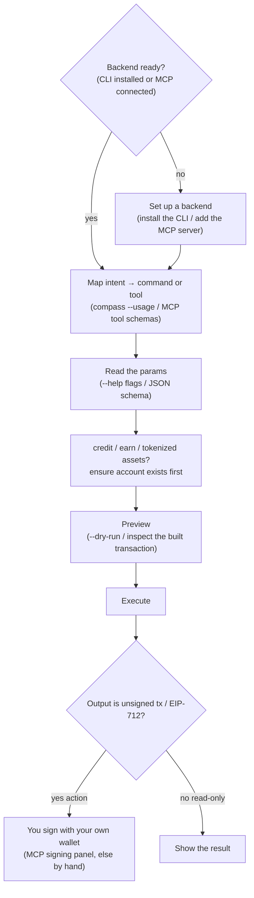

# Compass — DeFi skill for AI coding agents

Do on-chain DeFi from your coding agent by delegating to the [Compass Labs](https://compasslabs.ai) DeFi API through the `compass` CLI or the hosted MCP server.

Describe an action in plain English — _"supply USDC to Aave"_, _"find the best USDC vault on Base and deposit 100"_, _"open a 2x long on ETH"_, _"buy tokenized TSLA"_ — and the agent sets up a backend if needed, finds the right command or tool, previews it, runs it, and hands any resulting transaction to your wallet to sign.

**Non-custodial:** the CLI and the MCP tools return unsigned transactions / EIP-712 typed data. Compass never holds your keys, signs, or broadcasts.

One skill, multiple agents — the content in `skills/compass/` is shared; each agent just has a thin manifest.

## Install

### Claude Code
```text
/plugin marketplace add CompassLabs/compass-agent-skill
/plugin install compass@compass-labs
```

### Cursor / Codex
This repo ships `.cursor-plugin/` and `.codex-plugin/` manifests that point at the shared `skills/`. Install it through your agent's plugin mechanism (point it at this git repo), or copy `skills/compass/` into your agent's skills directory.

### Any other agent (universal)
Point your agent at **`AGENTS.md`** (or `GEMINI.md`) in this repo — it's the same guidance in the widely-read AGENTS.md format. Many agents (Codex, Aider, Cline, Gemini CLI, …) pick it up automatically when it's in the working directory.

### MCP server (no CLI install)
Prefer native tools over a binary? The Compass API hosts its own MCP server at `https://api.compasslabs.ai/mcp`. Auth is your regular Compass API key (get one at <https://compasslabs.ai/login>) sent as an `X-API-Key` header — e.g. for Claude Code:

```bash
claude mcp add --transport http compass https://api.compasslabs.ai/mcp \
  --header "X-API-Key: YOUR_API_KEY"
```

Per-client setup (Cursor, Claude Desktop, any Streamable-HTTP client) is in the [MCP server docs](https://docs.compasslabs.ai/v2/Agents/MCP-Server). The same skill concepts apply; the agent calls the Compass tools natively instead of shelling out to the CLI.

In clients that render MCP Apps views (Claude's chat apps, for example), tools that build a transaction also show a **signing panel**: you review the request and sign it with your own wallet in the browser, and the result goes back to the chat. Where there is no panel (terminal agents, the CLI), the skill walks you through signing with your own key instead.

## Use

```text
/compass find the highest-yield USDC vault on Base and deposit 100
```

Or just describe a DeFi action in chat — the skill activates on DeFi intents.

## How it works



## Requirements

- **A Compass API key** (get one at <https://compasslabs.ai/login>): `export COMPASS_API_KEY_AUTH=...` for the CLI, or the `X-API-Key` header for the MCP server.
- **One backend.** The MCP server needs nothing installed (see above). For the `compass` CLI, the skill installs it on first use, or:
  ```bash
  curl -fsSL https://compasslabs.ai/install.sh | bash      # macOS / Linux
  iwr -useb https://compasslabs.ai/install.ps1 | iex       # Windows
  # or
  go install github.com/CompassLabs/cli/cmd/compass@latest
  ```

## What it does NOT do

- Sign or broadcast transactions — that's your wallet (or the gas-sponsorship flow).
- Track positions over time — it's a stateless API client; query each time.
- Manage on-chain approvals — your wallet's job (or Permit2 via gas sponsorship).

## Layout (for maintainers)

- `skills/compass/` — the skill content, **single source of truth**.
- `.claude-plugin/`, `.cursor-plugin/`, `.codex-plugin/` — per-agent manifests, all pointing at `skills/`.
- `AGENTS.md`, `GEMINI.md` — generated universal-file representations of the skill (don't edit by hand).
- `scripts/generate_agents_md.py` — regenerates those two files from `skills/compass/`. Run it after every edit to the skill; `--check` fails when they are stale.

To release: edit `skills/compass/`, run the generator, bump `version` in the three plugin manifests and `.claude-plugin/marketplace.json`, commit and tag.

## Links

- compass CLI: <https://github.com/CompassLabs/cli>
- API docs: <https://docs.compasslabs.ai>
- Website: <https://compasslabs.ai>
